# Rapport de TP 3 — Sécurité des conteneurs et monitoring en runtime

**Université :** INSAT  
**Classe :** GL5  
**Année universitaire :** 2026/2027  

**Équipe :**

- Ahmed Jammoussi
- Mohamed Taher Ben Hassine
- Yassine Sallemi
- Youssef Fadhloun

---

## 1. Objectif

Le TP 3 porte sur trois contrôles qui interviennent après le code : l'image Docker, les secrets au déploiement, et la détection d'un comportement anormal une fois le conteneur démarré.

L'application est la Notes API Flask déjà durcie aux TP 1 et 2. Elle lit une clé `API_KEY` dans l'environnement et expose `/status`, qui indique seulement si la clé est présente et quelle est sa longueur. La valeur n'est jamais renvoyée.

Le travail se fait en trois temps :

1. Scanner une image volontairement faible avec Trivy, puis reconstruire une image minimale, non-root, sans secret.
2. Déployer l'image durcie sur Minikube et injecter `API_KEY` par un Secret Kubernetes.
3. Installer Falco sur le cluster, ouvrir un shell dans le pod, et montrer l'alerte.

---

## 2. Image faible

Le premier Dockerfile part de `python:3.9`, n'ajoute pas d'utilisateur, et écrit le secret dans l'image avec `ENV API_KEY=super-secret-lab-key`.

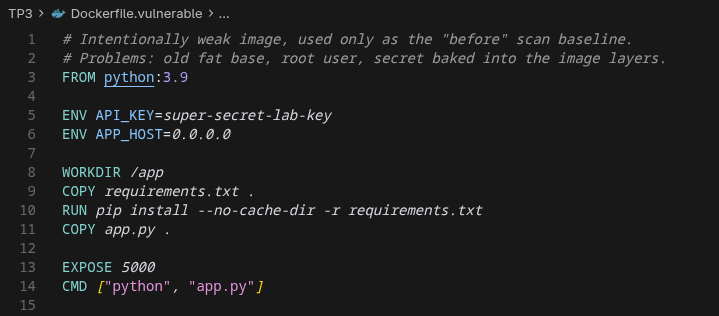

Trois problèmes en découlent :

- la base est une Debian complète et un Python ancien, donc une grande surface de paquets ;
- le processus tourne en root ;
- la clé reste lisible par `docker inspect` pour quiconque obtient l'image.

La construction de `notes-api:vulnerable` le montre directement. `docker inspect` laisse le champ utilisateur vide (le processus est root) et affiche `API_KEY=super-secret-lab-key` dans l'environnement de l'image. Docker émet aussi l'avertissement `SecretsUsedInArgOrEnv` : une instruction `ENV` ne doit pas porter de donnée sensible.

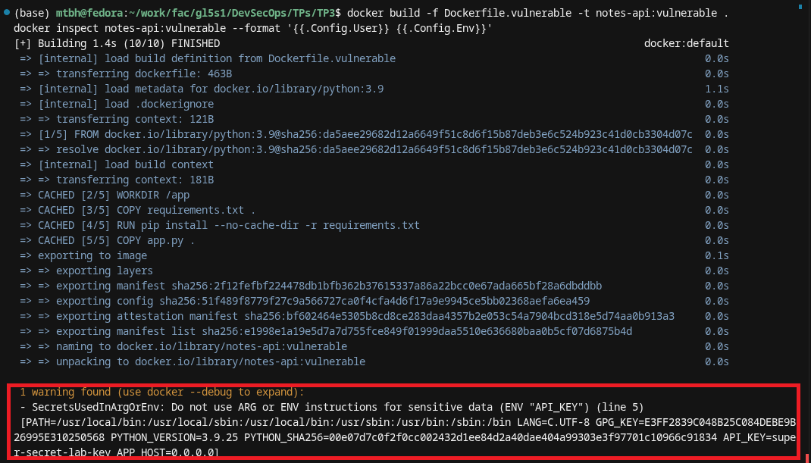

Trivy, limité aux sévérités HIGH et CRITICAL, confirme la surface de la base. Sur `notes-api:vulnerable` (Debian 13.1), le système compte **2774** vulnérabilités, dont **2539 HIGH** et **235 CRITICAL**.

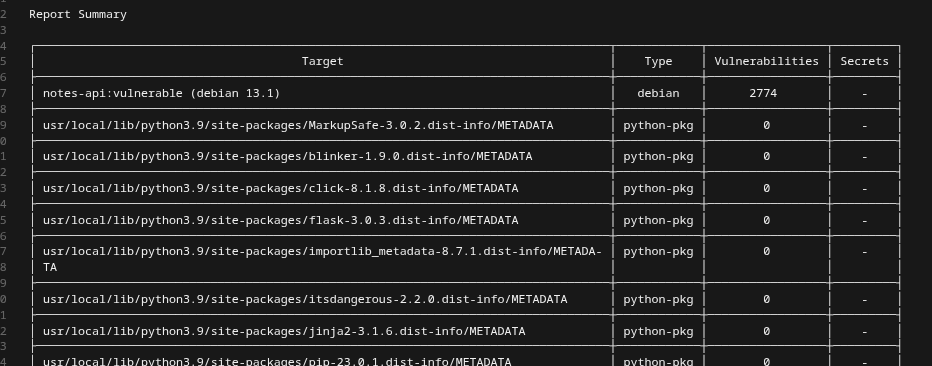

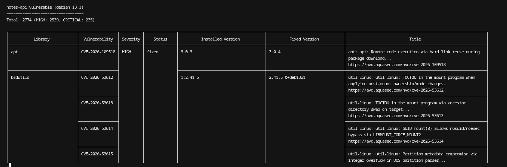

Les paquets Python de l'application ajoutent **3 HIGH** et **0 CRITICAL** : `jaraco.context` (CVE-2026-23949) et `wheel` (CVE-2026-24049). Ce sont des paquets de métadonnées, pas le code Flask.

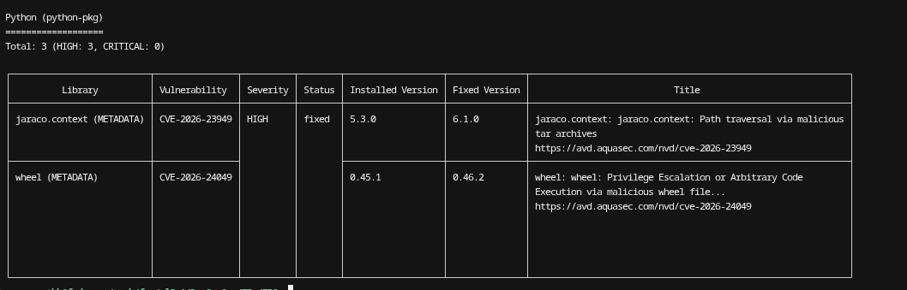

---

## 3. Image durcie

Le Dockerfile retenu change quatre points :

- base `python:3.12-slim-bookworm`, qui retire l'essentiel des paquets dont l'application n'a pas besoin ;
- utilisateur `appuser` (uid 10001), et `USER appuser` avant le `CMD` ;
- aucun `API_KEY` dans les instructions : la clé n'existe qu'au démarrage du conteneur ;
- `pip install --no-cache-dir` pour ne pas laisser le cache de téléchargement dans un layer.

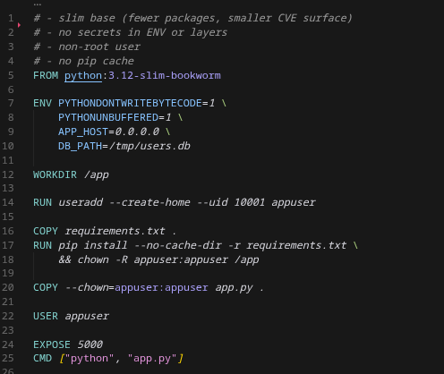

Après construction, `docker inspect` montre `User=appuser` et une variable d'environnement sans `API_KEY`.

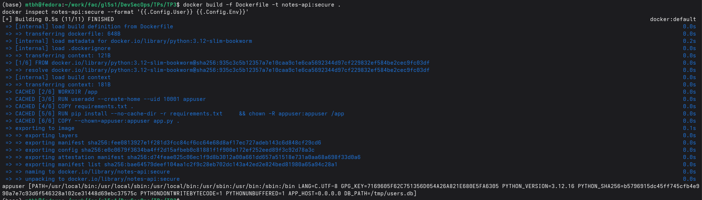

Le second scan Trivy porte sur `notes-api:secure` (Debian 12.15). Le système passe de 2774 à **98** vulnérabilités : **96 HIGH** et **2 CRITICAL**. Les paquets Python de l'application sont à **0**.

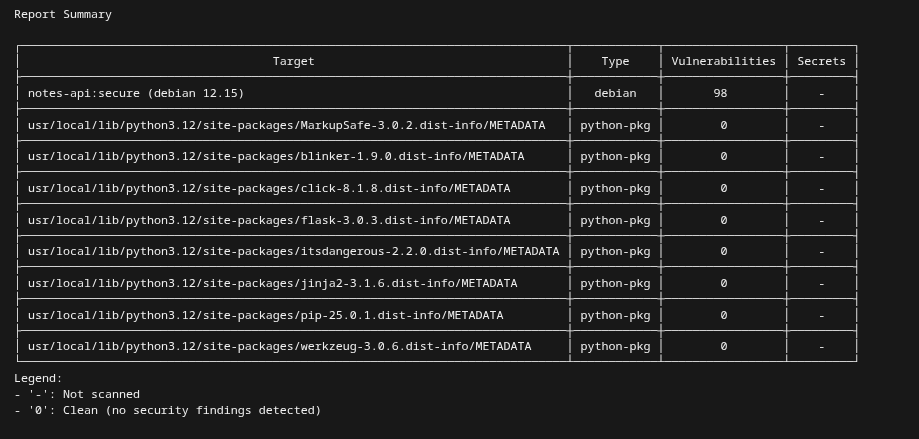

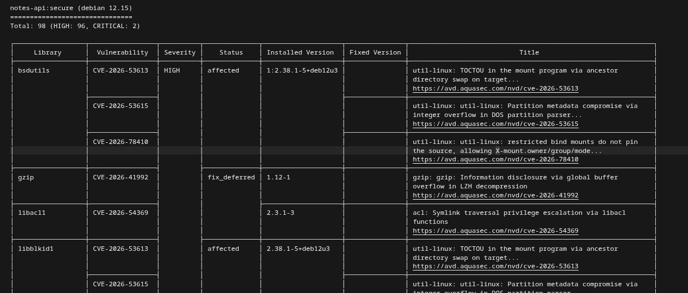

| | Image faible | Image durcie |
|---|---|---|
| Base | `python:3.9` (Debian 13.1) | `python:3.12-slim-bookworm` (Debian 12.15) |
| Utilisateur | root | `appuser` (uid 10001) |
| Secret dans l'image | `API_KEY` en `ENV` | absent |
| OS, HIGH + CRITICAL | 2774 (2539 + 235) | 98 (96 + 2) |
| Paquets Python, HIGH | 3 | 0 |

Les 98 vulnérabilités restantes sont des CVE de paquets Debian encore présents dans l'image slim (`bsdutils`, `gzip`, `libc6`). Elles ne se corrigent pas dans le Dockerfile de l'application : elles partent quand la base publie une mise à jour. Le gain mesuré est le passage de 2774 à 98, et la disparition du secret et du root.

---

## 4. Secret Kubernetes

`app.py` ne contient pas la clé. Il la lit avec `os.environ.get("API_KEY", "")`. La route `/status` ne renvoie que `secret_configured` et `secret_length`.

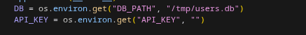

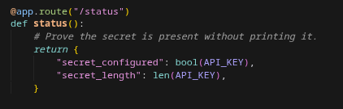

Le cluster est un Minikube local. L'image `notes-api:secure` y est chargée avec `minikube image load`, car elle n'est pas sur un registre.

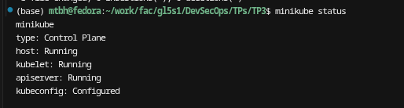

Le Secret `notes-api-secret` dans le namespace `notes` porte la clé en `stringData`. Kubernetes la stocke ; elle n'est pas dans le dépôt comme valeur utilisée par l'image, et elle n'est pas dans les layers.

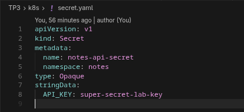

Le Deployment fixe `runAsNonRoot` et `runAsUser: 10001`, retire toutes les capabilities, et injecte la clé avec `secretKeyRef` sur le Secret précédent.

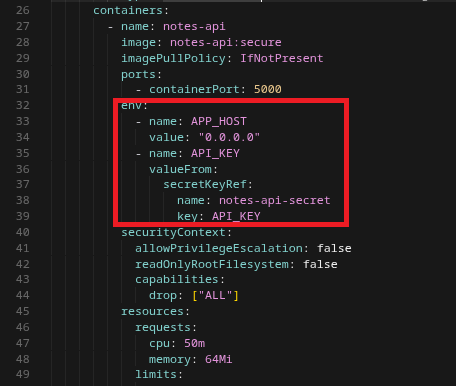

Après `kubectl apply`, le pod `notes-api` est `Running` et le Secret est présent dans le namespace.

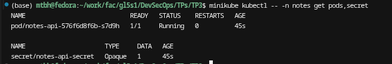

Un `port-forward` vers le Service, puis `curl http://127.0.0.1:5000/status`, renvoie :

```json
{"secret_configured": true, "secret_length": 20}
```

La longueur 20 correspond à la clé du Secret. La valeur elle-même n'apparaît pas dans la réponse.

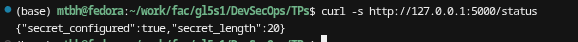

---

## 5. Falco

Falco est installé dans le namespace `falco` avec Helm (`driver.kind=modern_ebpf`). Le pod est `Running`.

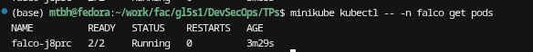

Le comportement simulé est un shell interactif dans le pod de production :

```bash
minikube kubectl -- -n notes exec -it deploy/notes-api -- /bin/sh
whoami
```

`whoami` affiche `appuser`, ce qui confirme que le shell obtenu n'est pas root.

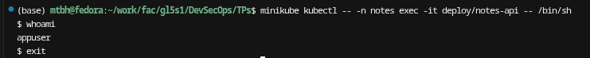

Falco émet l'alerte au moment où le shell est créé (`execve` de `sh`), pas au moment de `whoami`. La règle observée est **A shell was spawned in a container with an attached terminal**. La ligne indique `user_uid=10001`, `container_name=notes-api`, `container_image_tag=secure`, `k8s_pod_name=notes-api-576f6d8f6b-s7d9h` et `k8s_ns_name=notes`.

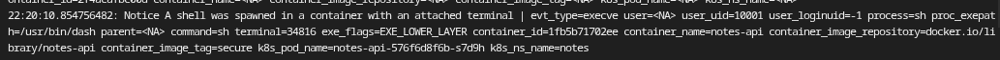

Minikube avec le driver Docker partage le noyau de la machine. La sonde eBPF voit donc aussi des conteneurs Docker hors cluster. Leurs événements ont `k8s_pod_name=<NA>`. L'alerte retenue pour le TP est celle dont le namespace est `notes`.

---

## 6. Bilan

- L'image passe de `python:3.9` en root, avec le secret dans `ENV`, à `python:3.12-slim` exécutée par `appuser`, sans secret dans les layers. Trivy mesure le résultat : 2774 vulnérabilités HIGH/CRITICAL sur l'OS, puis 98.
- La clé est fournie au pod par un Secret Kubernetes (`secretKeyRef`). `/status` prouve qu'elle est disponible sans l'afficher.
- Falco, déployé sur le cluster, signale le shell ouvert dans `notes-api` par la règle *A shell was spawned in a container with an attached terminal*.
